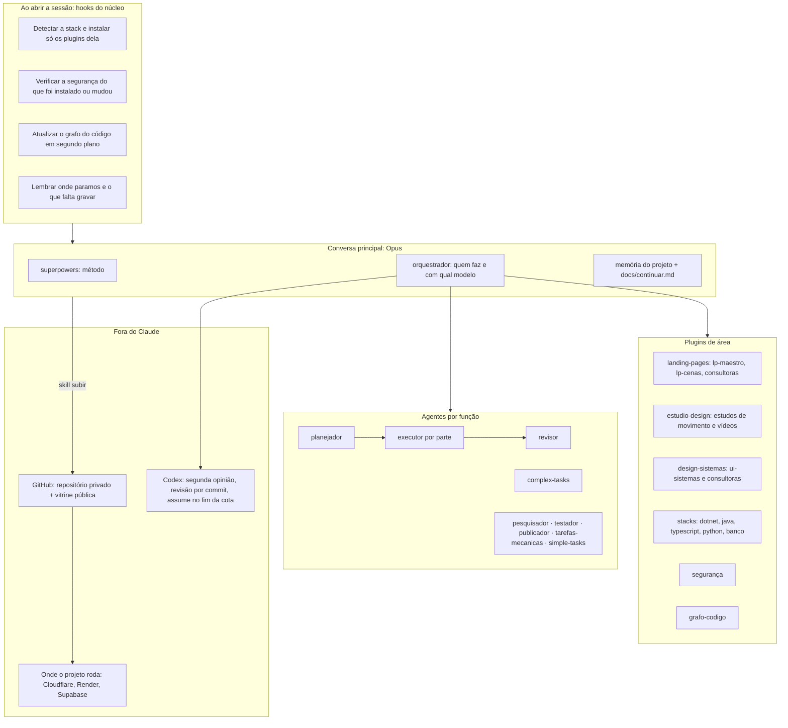
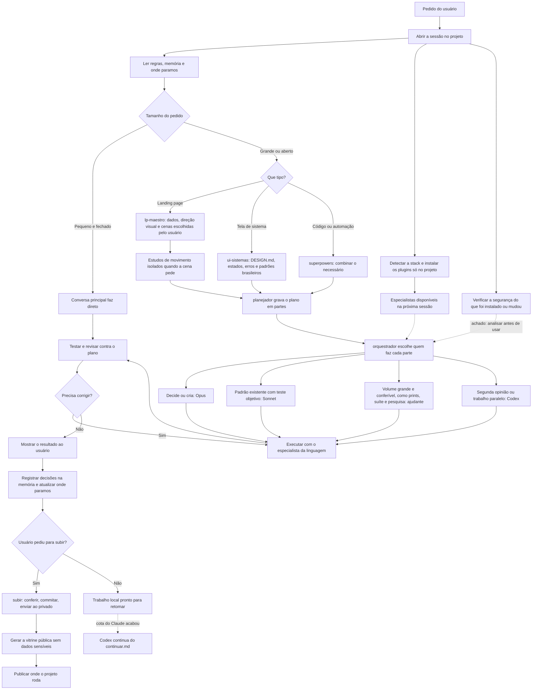

# DevConductor

Ecossistema de desenvolvimento para Claude Code: **método** (superpowers) + **especialistas por stack**
(selecionados do wshobson/agents) + **camada própria** (roteamento de modelo, memória, subir, detecção de stack).

Plano completo: [docs/plano-de-acao.md](plano-de-acao.md) · Decisões: [docs/decisoes.md](decisoes.md)

Para trabalhar neste repositório (testes, versões, commits, Codex): [CLAUDE.md](../CLAUDE.md).
Para ver o que esta máquina tem e o que falta para cada parte do kit (com o comando de instalação):
`node scripts/diagnostico.mjs`.

## Plugins

| Plugin | O que tem |
|---|---|
| `devconductor-core` | agentes por função com modelo e esforço próprios: `planejador` (opus, high), `executor` (opus, medium), `revisor` (opus, medium), `complex-tasks` (opus, high), `simple-tasks` e `pesquisador` (sonnet, medium), `tarefas-mecanicas`, `testador`, `publicador` (Haiku); skills `orquestrador`, `memoria`, `subir`, `skill-scanner` (verificação de segurança de skills, da Sentry), `find-skills` (procura skills prontas no skills.sh e no GitHub, confere licença e segurança e instala só no projeto, da Vercel), `codex-parceiro` (Codex como segunda opinião e trabalho em paralelo, pela CLI `codex`); detecção de stack e avisos de espera e conversa longa |
| `stack-dotnet` | `dotnet-architect`, `csharp-pro` + padrões .NET e C# moderno |
| `stack-java` | `java-pro` |
| `stack-typescript` | `typescript-pro`, `javascript-pro` + tipos avançados, JS moderno, Node, testes, React (Vercel) |
| `stack-python` | `python-pro`, `fastapi-pro` + 7 skills de Python |
| `stack-banco` | `database-architect` (opus), `sql-pro`, `database-optimizer` + Postgres e Supabase |
| `seguranca` | `backend-security-coder`, `frontend-security-coder`, `security-auditor` + SAST |
| `landing-pages` | `lp-maestro` (conduz) + 9 `lp-*` por etapa + `lp-cenas` (cenas guiadas pelo scroll) + 17 consultoras famosas travadas (ver `plugins/landing-pages/FONTES.md`) |
| `estudio-design` | estudos isolados de movimento em React + GSAP, teste responsivo, vídeos e vitrine; liga com landing pages ou marcador `.estudio-design` |
| `design-sistemas` | `ui-sistemas` (telas de sistema: DESIGN.md por projeto, estados, erros, listas, padrões brasileiros testados em `modelos/br.ts`, com CNPJ alfanumérico) + 5 consultoras travadas (`dashboard-design`, `baseline-ui`, `fixing-accessibility`, `improve-ui`, `create-design-md`; ver `plugins/design-sistemas/FONTES.md`); liga em projeto React/Next com roteador, formulário, tabela, consulta ou login (fora da fábrica de landing pages) ou com o marcador `.design-sistemas` |
| `grafo-codigo` | mapa do código com o [Graphify](https://github.com/safishamsi/graphify) (só AST: local, sem LLM, sem tokens) e a skill que consulta o grafo antes de grep e leituras em série; liga sozinho em projeto com 200+ arquivos de código ou com o marcador `.graphify`. Precisa da CLI uma vez por máquina: `uv tool install graphifyy` (ou `pipx install graphifyy`) |

O método vem do **superpowers**, instalado do marketplace oficial (não é copiado).

## Como funciona num projeto

1. O `devconductor-core` fica ligado.
2. Ao abrir a sessão, o hook olha os arquivos (`.sln`/`.csproj`, `pom.xml`, `package.json`, `.py`,
   `supabase/`, dependências de banco, backend, pasta `clientes/` ou marcador `.landing-pages`) e instala **só** os plugins de stack daquele projeto,
   no escopo local (`.claude/settings.local.json`, fora do git). Os especialistas entram na sessão seguinte.
3. O superpowers conduz o trabalho; a skill `orquestrador` decide quem faz (direto, agente ou Codex), escolhe o especialista pela stack dos
   arquivos e o modelo pela classificação MECÂNICA / SIMPLES / COMPLEXA.
   A [tabela de responsabilidades](responsabilidades-skills.md) dá uma origem e um dono a cada skill.
   Consultoras entram só pela etapa atual; uma cópia global não é carregada junto com a mesma skill do kit.
4. Ao abrir a sessão e logo depois de um comando de instalação (`claude plugin install`, `npx skills add`,
   `git clone` de skill), o núcleo verifica só o que é novo ou mudou: skills passam pelo verificador da Sentry
   (precisa do [uv](https://docs.astral.sh/uv/) ou python com pyyaml) e plugins têm os comandos dos hooks
   listados. O que tiver achado vai para a sessão, que faz a análise completa com a skill `skill-scanner`
   antes de usar. Nada é desligado sozinho.
5. Em projeto grande, o `grafo-codigo` atualiza o grafo em `graphify-out/` (fora do git, pelo
   `.git/info/exclude`) a cada sessão, em segundo plano, e o agente consulta o grafo
   (`graphify query`, `explain`, `path`, `affected`) antes de abrir arquivos. Para não ligar num projeto, marque
   `"grafo-codigo@devconductor": false` em `enabledPlugins` no `.claude/settings.local.json`.
6. Quando o Claude pede permissão ou termina e fica esperando, aparece um aviso do sistema (Windows: balão do
   Windows, sem instalar nada; macOS: Central de Notificações; Linux: `notify-send`) com o nome da pasta do
   projeto. Não aparece na nuvem nem no app do Claude, que já avisam. Para desligar: variável `DEVCONDUCTOR_AVISO=0` (o nome antigo `DEVAGENTS_AVISO` ainda vale)
   (por exemplo em `"env"` no `.claude/settings.local.json`).

### Mapa das peças



### Fluxo de um pedido



A direção visual é apresentada em HTML (ou no Figma). A publicação acontece só quando o usuário pedir.

Ligar ou desligar o DevConductor num projeto (só nesta máquina, fora do git do projeto):

```bash
node scripts/instalar.mjs "<pasta do projeto>"
```
```bash
node scripts/instalar.mjs "<pasta do projeto>" --desligar
```
Com `--simular`, só mostra o que faria.

Já usava com o nome antigo (`devagents`)? Rode o mesmo comando em cada projeto: ele retira o catálogo antigo da
máquina, registra o `devconductor` e troca os plugins mantendo o que estava ligado ou desligado.

Com `--github`, o catálogo é registrado pelo repositório do GitHub (o `origin` do clone, ou
`--github dono/repositório`) em vez da pasta: a configuração do projeto não guarda caminho desta máquina e
`claude plugin marketplace update devconductor` traz as versões novas publicadas.

Numa máquina sem o clone, os mesmos passos à mão (na pasta do projeto); as stacks entram sozinhas na
primeira sessão aberta ali, pelo hook do núcleo, e os especialistas na sessão seguinte:

```bash
claude plugin marketplace add neemiasjls/DevConductor-public --scope local
```
```bash
claude plugin marketplace add anthropics/claude-plugins-official --scope local
```
```bash
claude plugin install superpowers@claude-plugins-official --scope local
```
```bash
claude plugin install devconductor-core@devconductor --scope local
```

Se uma etapa falhar, o instalador termina com erro e informa o que ficou incompleto. Ao desligar, tenta
remover todos os plugins e relata as falhas; plugins que já estavam ausentes não impedem a conclusão.
O instalador também cadastra o catálogo oficial necessário ao superpowers, inclusive no primeiro uso do CLI.

Simular a detecção sem instalar nada:

```bash
node plugins/devconductor-core/hooks/detectar-stack.mjs --projeto "<pasta do projeto>" --dry-run
```

## Claude + Codex

Quando o limite do Claude acaba, o Codex assume pelos mesmos arquivos (`docs/continuar.md`, `CLAUDE.md`,
skills). Preparar uma vez com `node scripts/espelhar-codex.mjs`; passo a passo em
[docs/troca-de-turno.md](troca-de-turno.md).

Trabalhando junto (precisa do Codex de terminal: `npm install -g @openai/codex` e `codex login`):

- **No mesmo computador:** a skill `codex-parceiro` faz o Claude chamar o Codex pela CLI (`codex exec`,
  `codex review`) em tarefa COMPLEXA (revisão antes de dar como pronta, segunda opinião) ou independente (em
  paralelo, num worktree). Só a resposta final volta para o Claude; o Codex só lê, a não ser numa tarefa combinada.
  O `codex mcp-server` não existe mais (Codex 0.163): o caminho é a CLI.
- **Claude na nuvem, Codex no PC:** `scripts/vigia-codex.ps1` confere a cada 3 minutos se chegou commit novo na
  branch de trabalho e, só então, pede ao Codex (só leitura) a revisão da diferença; a revisão vai para a branch
  `codex/revisoes`, onde o Claude lê e corrige. Enquanto não chega commit, não gasta crédito.

  ```powershell
  pwsh -ExecutionPolicy Bypass -File scripts\vigia-codex.ps1 -Branch <branch de trabalho> -Minutos 3
  ```

## Medir o gasto

```bash
node scripts/medir-uso.mjs "<pasta do projeto>" --dias 7
```
Tokens por sessão e por modelo (inclui subagentes e sessões em worktree), lidos do histórico local.
`--todos` mostra o total de cada projeto. Para saber quanto cada plugin pesa só por estar ligado:
`node scripts/peso-plugins.mjs` (hoje ~4 mil tokens com tudo ligado — o grosso do contexto costuma vir
de conectores MCP e das regras do próprio projeto).

Para medir uma tarefa dentro de uma sessão longa, use `--sessao <id>` e um intervalo com fuso horário:

```bash
node scripts/medir-uso.mjs "<pasta do projeto>" --sessao <id> --de 2026-10-15T19:00:00Z --ate 2026-10-15T19:05:00Z --json
```

`--json` exporta os números exatos. Os filtros de horário e `--dias` se aplicam às mensagens, incluindo
subagentes. O medidor respeita `CLAUDE_CONFIG_DIR` quando definido.

Históricos copiados podem repetir respostas entre sessões, inclusive com o consumo zerado. O total geral
conta cada `message.id` uma vez, conservando o registro de maior consumo. Os números individuais das
sessões podem se sobrepor: o relatório indica os arquivos e as mensagens compartilhadas; não some essas
linhas para obter o total do projeto.

Para comparar as tarefas fixas do ensaio com evidências de qualidade, use
`node scripts/auditar-ensaio.mjs "<plano.json>"` antes de comparar. A opção
`--ensaio "<plano.json>"` de `scripts/comparar-medicoes.mjs` bloqueia rodadas pendentes/reprovadas e exige
as três repetições da mesma tarefa nos grupos `base` e `depois`.
[Formato, critérios e códigos de saída](historico/qualidade-ensaio.md). Os artefatos ficam locais; a auditoria
não chama modelos, não modifica o ensaio e não substitui a revisão visual.
Para servidores descartáveis, use o [escopo de processos de teste](servidores-de-teste.md): inicia o
Node sem shell e espera o encerramento antes de liberar a revisão ou remover a pasta temporária.

## Manutenção

### Responsabilidades e duplicatas

`node scripts/auditar-responsabilidades.mjs` confere cobertura, identidade, donos e ativação das consultoras.
Skill nova ou movida exige atualizar a matriz do orquestrador e regenerar a tabela com
`node scripts/auditar-responsabilidades.mjs --markdown`.
Com `--globais`, compara também skills/agentes globais, somente em leitura, deduplicando links para o mesmo
arquivo. Use `--json` para relatório estruturado. Nada é removido, instalado ou carregado no contexto por essa auditoria.

### Estúdio de movimento

Antes de integrar uma animação ao site, a skill `estudio-design:estudio-movimento` cria opções isoladas
para comparar. O [modelo](../plugins/estudio-design/skills/estudio-movimento/modelo/README.md) tem 25 estudos:
tipografia, fotos, linhas/mapas, transições, dados e profundidade. No celular a leitura segue vertical;
pausa e movimento reduzido mantêm o conteúdo inteiro.

```bash
node plugins/estudio-design/skills/estudio-movimento/scripts/criar.mjs pilotos/estudios
```

Siga o README gerado para instalar as dependências, baixar a foto gratuita e abrir o servidor local.
Os scripts `testar.mjs` e `gravar.mjs` da mesma skill verificam quatro modos, gravam computador/celular
e geram `vitrine/galeria.html` com seleção de favoritos. Gravar exige o plugin `landing-pages` e ffmpeg.
Defina `BROWSER_EXECUTABLE` para usar outro Chromium e `FFMPEG_PATH` quando o ffmpeg não estiver no PATH.
Não há publicação automática nem aprovação automática das cenas.

### Estilos e coleta de landing pages

O [catálogo de estilos](../plugins/landing-pages/skills/lp-direcao-de-arte/estilos/README.md) reúne quatro
direções com fontes, cores, grade, ritmo e receitas. Exemplos locais: `node pilotos/estilos/servir.mjs`,
em http://127.0.0.1:5192/, com vídeos de computador/celular para comparar.
O maestro busca fatos públicos com fontes, limita as perguntas ao dono a cinco e prepara três conceitos
completos. Dados ausentes ficam pendentes; a escolha visual e a publicação não são automáticas.

### Catálogo e importação

- Os plugins de stack são gerados por `scripts/importar.mjs` a partir de `scripts/selecao.json`
  (o que copiar, modelo e descrição em português). A origem de cada arquivo fica em `fontes.json`.

  ```bash
  git clone --depth 1 https://github.com/wshobson/agents <pasta-temporaria>
  node scripts/importar.mjs <pasta-temporaria>
  ```

- **Mudou um plugin? Suba a versão** no `plugin.json` dele e atualize a versão correspondente em
  `.claude-plugin/marketplace.json` com:

  ```bash
  node scripts/atualizar-marketplace.mjs
  ```

  Esse comando preserva agentes, skills e os metadados do catálogo. Sem versão nova, `claude plugin update`
  não copia a mudança para o cache.
- Use `importar.mjs` quando quiser copiar os arquivos da origem novamente. Ele prepara todas as cópias
  antes de substituir os arquivos, preserva versões e campos extras dos manifestos e mantém os créditos
  dos plugins que ficaram fora da seleção. Se uma substituição falhar, tenta restaurar os arquivos anteriores.
  A importação ainda substitui `agents/` e `skills/` dos plugins selecionados: confira as alterações locais.
- Ver o que mudou no wshobson desde a cópia: `node scripts/comparar-origem.mjs <clone novo>`.
- Validar: `claude plugin validate .`
- Conferir versões e links relativos das skills: `node scripts/auditar-referencias.mjs`.
- Testar instalação e manutenção sem alterar plugins reais: `node --test "scripts/testes/*.test.mjs"` (com aspas, o
  próprio node expande o `*`, também no PowerShell). O GitHub roda a mesma suíte e valida os plugins a cada envio,
  no Linux e no Windows (`.github/workflows/testes.yml`).
- Comparar medições (Fase 10): `node scripts/comparar-medicoes.mjs "base=<arquivos>" "outro=<arquivos>"` soma as
  sessões gravadas pelo `medir-uso --json` de cada grupo e mostra a diferença contra o primeiro, por categoria
  e por modelo (aceita `*` no nome do arquivo). Não estima preço.
- Testar com a CLI real numa configuração vazia: `node scripts/testar-instalacao-real.mjs`.
  O teste baixa plugins públicos, usa pastas isoladas em `pilotos/`, liga e desliga duas vezes e guarda
  logs e relatório nessa pasta. Não chama o modelo nem usa o login da sua configuração principal.
  Com `--github`, faz o mesmo com o catálogo vindo do GitHub e confere que nenhum caminho local ficou na
  configuração do projeto. Com `--sem-clone`, segue os 4 comandos acima e roda o hook do núcleo instalado
  (como na primeira sessão): confere que as stacks entram sozinhas e que abrir outra sessão não muda nada.

## Licenças de terceiros

Cada skill copiada de outro projeto leva o texto da licença original na própria pasta (os agentes do
wshobson/agents, em `plugins/<plugin>/LICENSES/`). Os arquivos Apache-2.0 alterados trazem o aviso de
modificação. Auditoria completa: [docs/licencas-publicacao.md](licencas-publicacao.md).

## Créditos

Ver [NOTICE](../NOTICE) e [fontes.json](../fontes.json).
